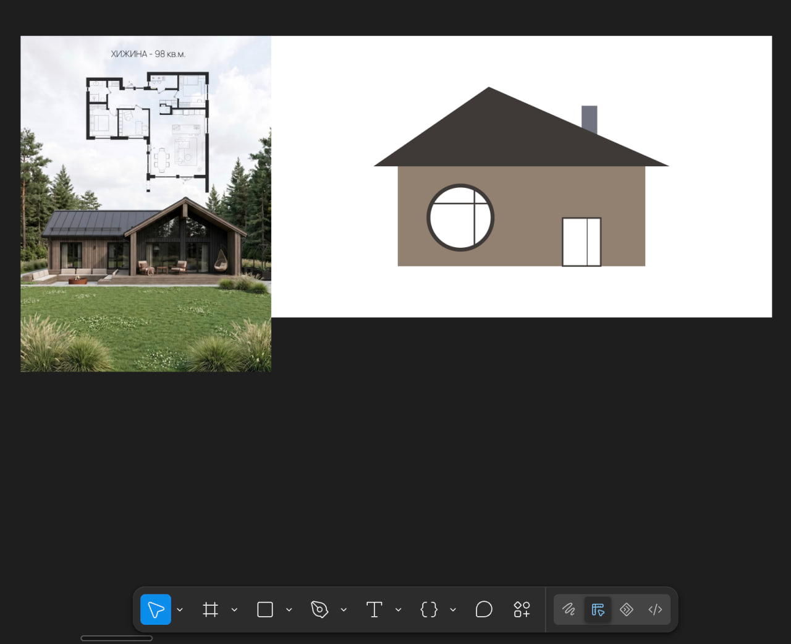
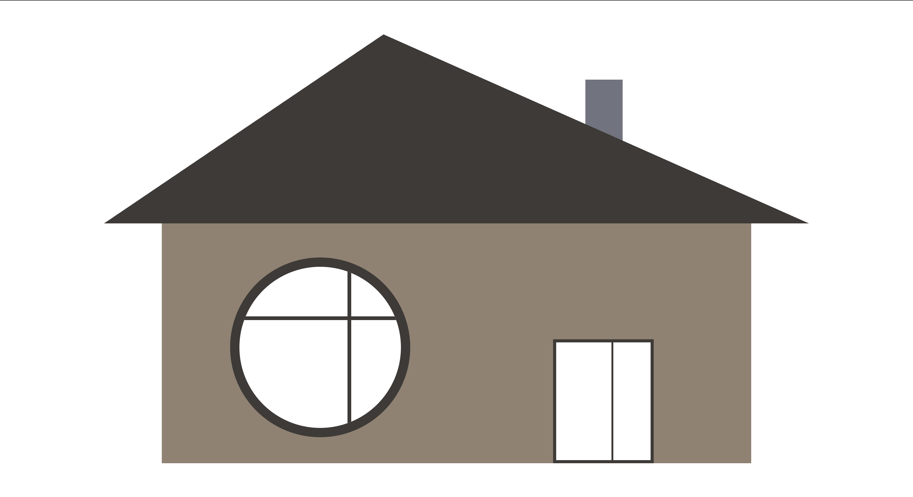
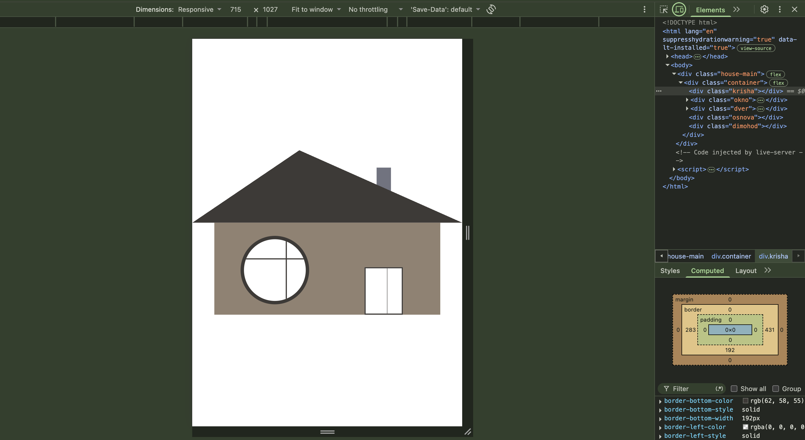
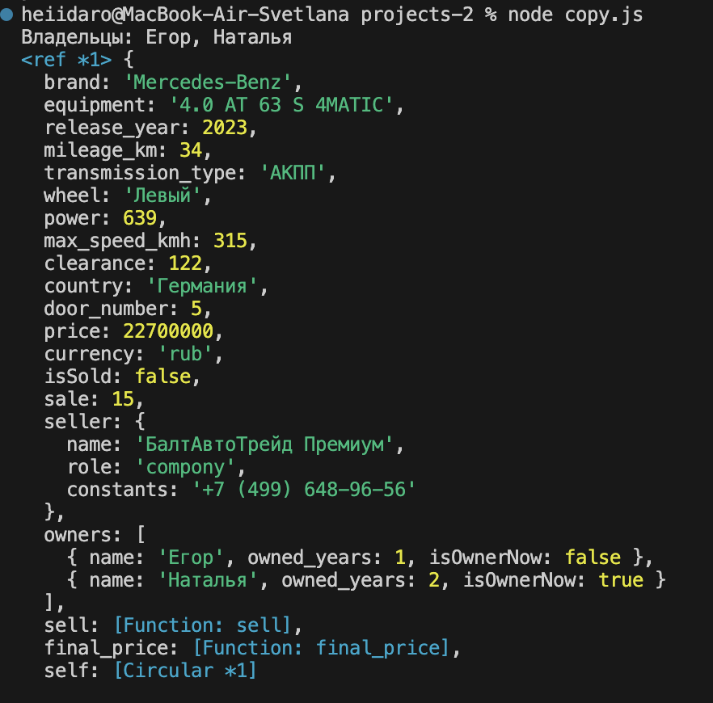
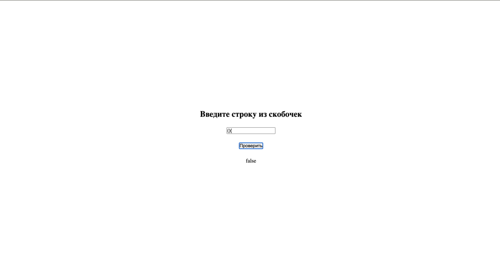
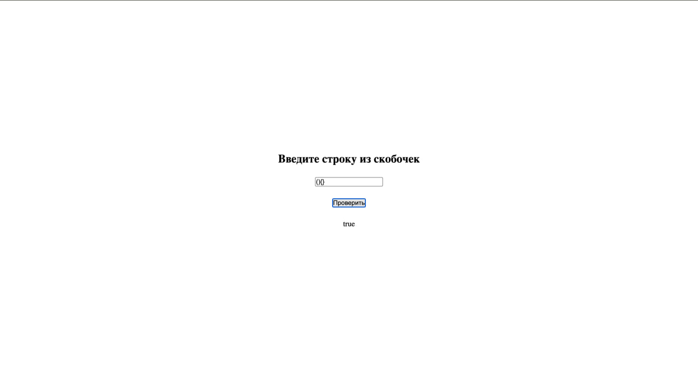
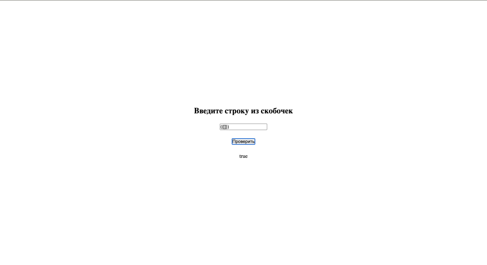
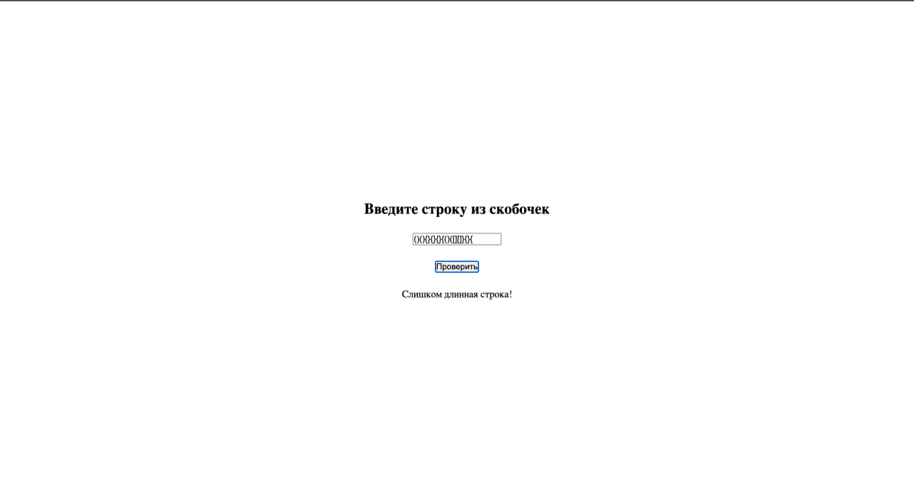
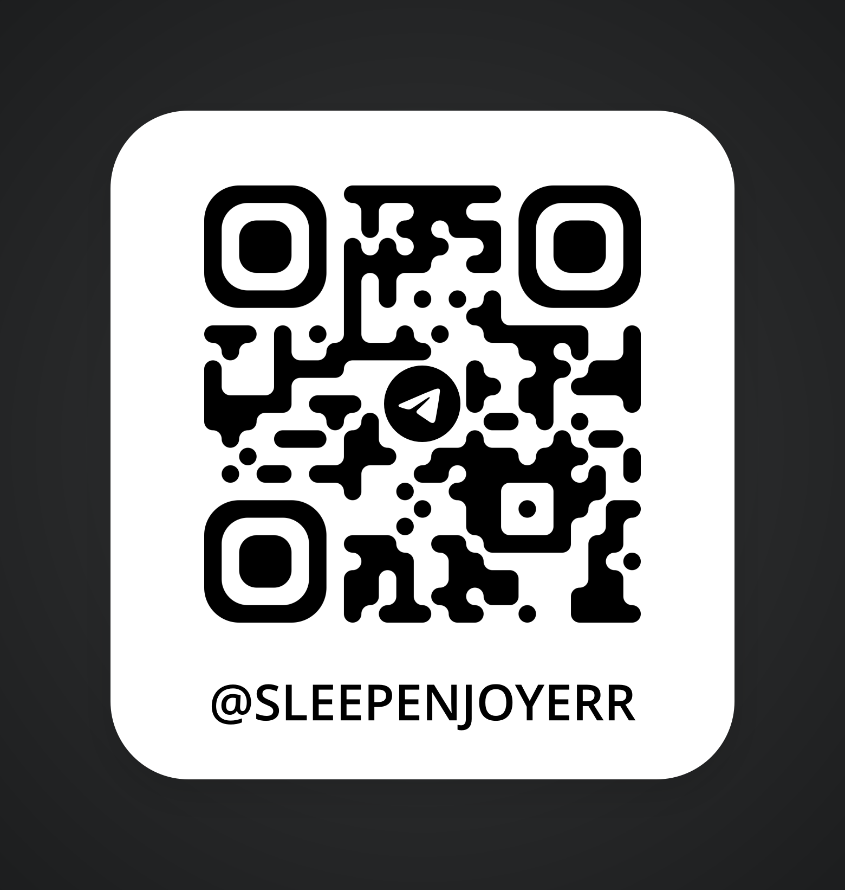

# Тестовое задание для Esoft

Здесь представлено 3 проекта, которые были заданы в google форме:

* Создание дома, используя только CSS стили
* Глубокое копирование
* Программа для решения задачи со скобками 

Каждая программа находится в соответствущей папке (projects-1, projects-2, projects-3)

В данном файле я расписала как были разработы файлы, результаты и с какими проблемами я сталкнулась в процессе. 

## Содержание

- [Тестовое задание для Esoft](#тестовое-задание-для-esoft)
  - [Содержание](#содержание)
  - [Задание 1](#задание-1)
  - [Задание 2](#задание-2)
  - [Задание 3](#задание-3)
  - [Благодарю за внимание, ниже также оставлю свои контакты](#благодарю-за-внимание-ниже-также-оставлю-свои-контакты)
   

## Задание 1

Перед началом написания кода, я решила сделать макет в Figma и визуализировать то, что я хотела бы реализовать

В качестве референса (примера) было изспользовано рандомное фото из интернета

Первый вариант был не адаптирован под размеры разных устройств и при уменьшении экрана все объекты сдвигались и картинка разрушалась как целостный объект

Чтобы изменить данную проблему мною было решено сделать адаптивную верстку через **@media** с указанием разных размеров экрана 

Этот вариант был уже лучше, чем предыдущий, но все же не идеальный. При уменьшении экрана менялся только размер контейнера, чтобы под него подстраивались все сотальные обхекты и также уменьшались.

Конечным решением было использовать еденицу измерения **em** для всех обхектов. Все они зависили от **font-size** главного контейнера. Размер шрифта не фиксированный, при уменьшении экрана по ширине более чем ширина контейнера - шрифт также уменьшается. Если размер экрана больше, чем ширина контейнера - размер фиксированный (10px)

**Резульат**

## Задание 2

В этом задании показывать не так много. Копирование произошло успешно. 

Даннае задание для меня было очень интересным. Из него я получил много нового опыта и знаний о работе с JS. Так как я больше занимаюсь разработкой на Python, то на JS некоторых моментов не знала. 

Например как скопировать объект глубоким копированием, создание объектов в JS и тд

## Задание 3

Для реализации решила использовать также html и css, вводлить строку и выводить результат непосредственно на web странице. Опять же, на python мне легче было бы сделать через консоль, но на JS я лучше знаю как привязать объекты из HTML в JS, исходя из опыта, колученного при оучении в колледже и разработке некоторых проектов.

Здесь представлю результаты 

")

Для проверки длины строки изменила сначала с **10 ** 4** на **2 ** 2**

## Благодарю за внимание, ниже также оставлю свои контакты

**Номер телефона** - +7 923 656 54 42

**Email:** svetashkunova200@gmail.com

**Telegram:** @sleepEnjoyerr

**GitHub:** @heiidaro
